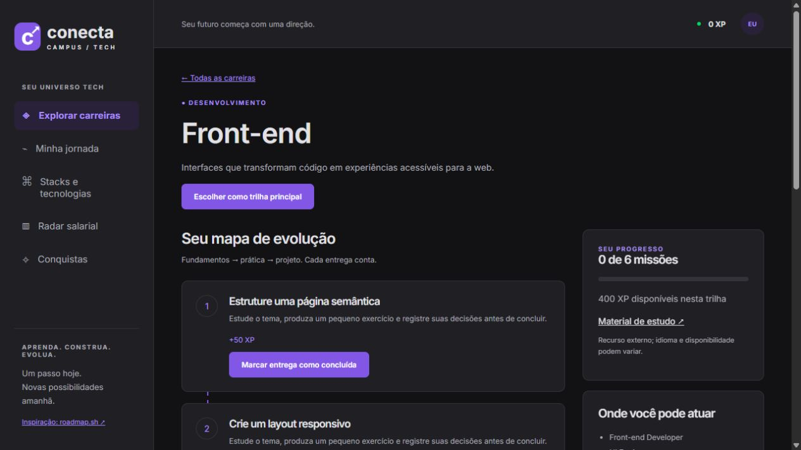
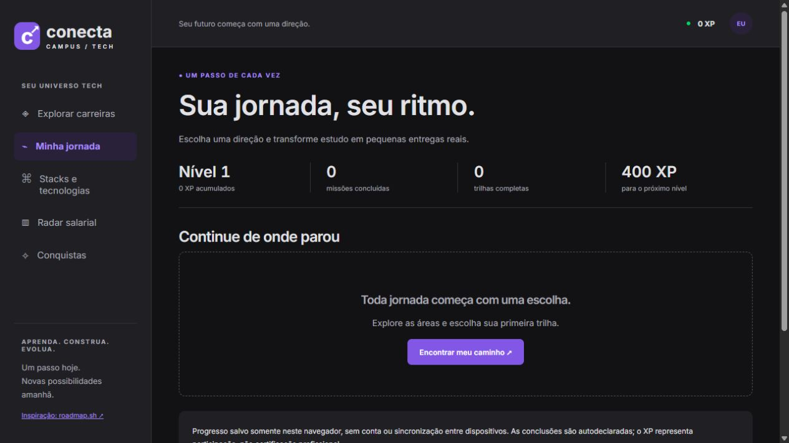
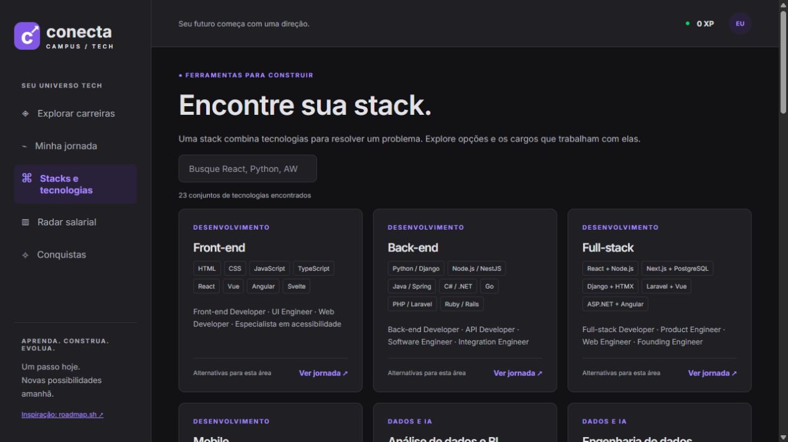
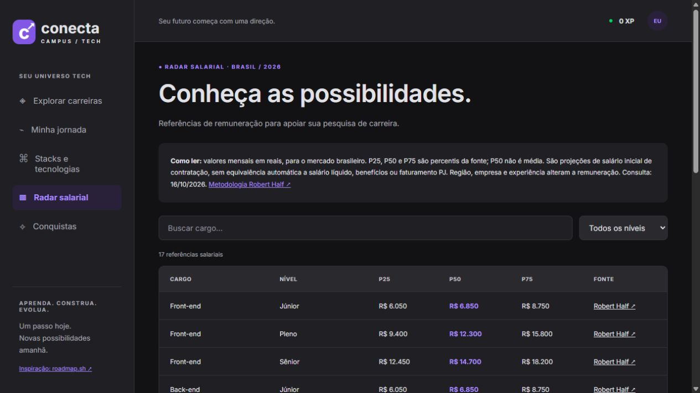
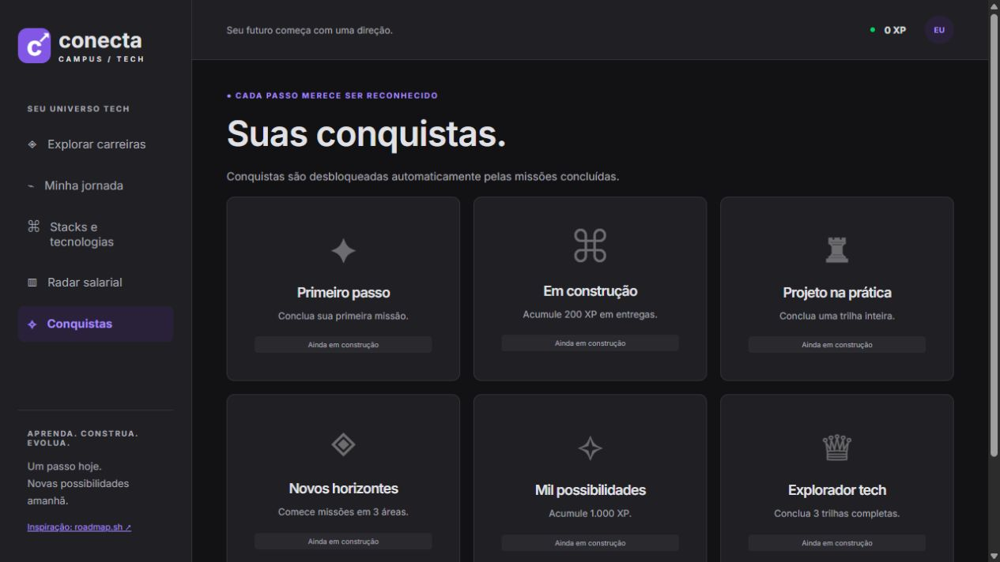
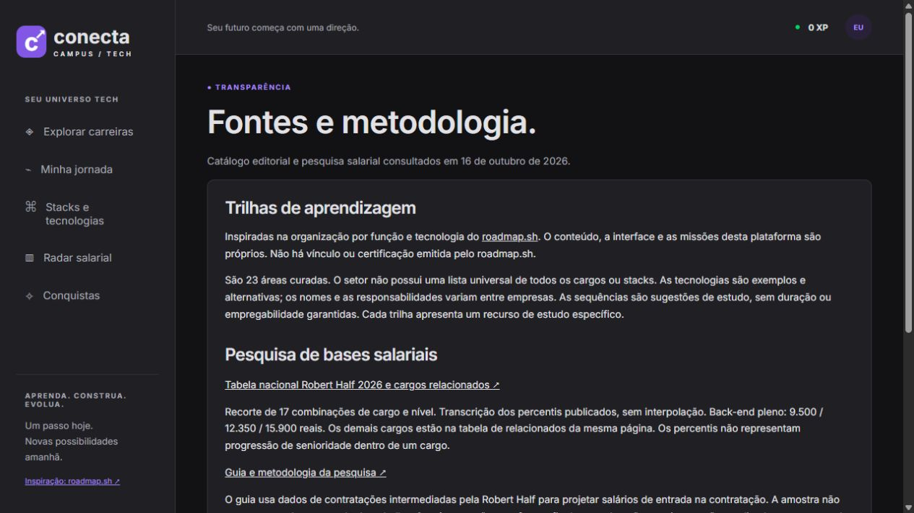

# Conecta Campus Tech

**Encontre seu caminho. Construa seu futuro.**

Plataforma de orientação de carreiras em tecnologia que reúne áreas de atuação, cargos, stacks, trilhas práticas e referências salariais brasileiras. A jornada gamificada transforma o estudo em pequenas entregas, com XP, níveis e conquistas.

Organização inspirada no [roadmap.sh](https://roadmap.sh/), com interface própria, paleta escura inspirada na Rocketseat e tipografia Inter.

## O que a plataforma oferece

| Conteúdo | Cobertura atual |
| --- | --- |
| Áreas de tecnologia | 23 |
| Cargos mapeados | 99 |
| Tecnologias e práticas distintas | 131 |
| Missões | 138 — seis por trilha |
| XP por trilha completa | 400 |
| Referências salariais | 17 combinações de cargo e nível |

- Busca por área, cargo ou tecnologia, com suporte a termos sem acentos.
- Filtros por grupo e ordenação por nome ou progresso.
- Escolha de uma trilha principal e acompanhamento das missões.
- Desbloqueio sequencial das etapas e projeto final em cada trilha.
- XP, níveis e conquistas calculados a partir das conclusões.
- Exportação e importação do progresso em JSON.
- Pesquisa salarial com filtros por cargo e senioridade, percentis e links para a fonte.
- Layout responsivo, navegação por teclado e controles rotulados.

O catálogo é curado e expansível. Cargos e stacks mudam com o mercado; não há uma lista universal e definitiva de todas as possibilidades da tecnologia.

## Telas da plataforma

As imagens abaixo são capturas reais da versão desktop, com tema escuro e fonte Inter. Elas mostram o estado inicial, sem progresso de estudo registrado. Os endereços indicados são caminhos relativos ao servidor local.

### 1. Explorar carreiras

**Caminho:** `/#explorar`

Página de entrada com os números do catálogo, campo de busca, filtros por área e cartões de carreiras. Cada cartão leva à trilha correspondente e apresenta exemplos de tecnologias.

### 2. Trilha de aprendizagem

**Exemplo de caminho:** `/#trilha/frontend`

Mostra as seis missões, o XP disponível, a barra de progresso, cargos relacionados, tecnologias e um recurso externo de estudo. A próxima etapa é liberada após a conclusão da anterior. Desfazer uma missão também reabre as etapas seguintes daquela trilha.

### 3. Minha jornada

**Caminho:** `/#jornada`

Reúne nível, XP, missões concluídas, trilhas completas e os caminhos já iniciados. A tela também oferece exportação e importação do progresso. Antes da primeira escolha, exibe uma orientação para encontrar uma trilha.

### 4. Stacks e tecnologias

**Caminho:** `/#stacks`

Catálogo pesquisável de tecnologias e práticas agrupadas por área de atuação, com cargos relacionados e acesso à jornada. Os itens apresentados são alternativas para a área, não requisitos simultâneos.

### 5. Radar salarial

**Caminho:** `/#salarios`

Tabela com referências nacionais mensais em reais, filtráveis por cargo e nível. Apresenta os percentis P25, P50 e P75, a data de consulta e acesso à fonte. P50 é percentil, não média salarial.

### 6. Conquistas

**Caminho:** `/#conquistas`

Apresenta seis conquistas, desbloqueadas automaticamente ao cumprir critérios como concluir uma missão, acumular XP ou completar trilhas. As conquistas ainda não obtidas ficam visualmente atenuadas.

### 7. Fontes e metodologia

**Caminho:** `/#fontes`

Explica as referências editoriais, a origem da pesquisa salarial, o recorte dos dados e o funcionamento do armazenamento do progresso.

## Tecnologias utilizadas

| Camada | Tecnologia |
| --- | --- |
| Servidor | Python e Flask 3.1.2 |
| Templates | Jinja2 e HTML |
| Interface | CSS e JavaScript sem framework |
| Catálogo | JSON estático |
| Dados administrativos | SQLite |
| Progresso das jornadas | localStorage do navegador |
| Tipografia | Inter, com alternativa Segoe UI/sans-serif |
| Publicação compatível | WSGI / PythonAnywhere |

## Como funciona a gamificação

1. Explore o catálogo e escolha uma trilha.
2. Estude o tema e produza a entrega sugerida na missão.
3. Marque a entrega como concluída para ganhar XP e liberar a etapa seguinte.
4. Complete as cinco primeiras etapas, de 50 XP cada, e o projeto final, de 150 XP.
5. Acompanhe sua evolução em Minha jornada e Conquistas.

Cada 400 XP acumulados elevam o nível em uma unidade. As conclusões são autodeclaradas: a plataforma não corrige exercícios nem emite certificação profissional. Exportar o progresso permite manter uma cópia ou importá-la em outro navegador.

## Pesquisa salarial e fontes

Os dados foram consultados em **16/10/2026**. O recorte contém 17 combinações de cargo e nível, com percentis publicados na [tabela nacional da Robert Half 2026 e cargos relacionados](https://www.roberthalf.com/br/pt/vagas-detalhes/desenvolvedora-back-end-pleno).

A [metodologia do Guia Salarial Robert Half](https://www.roberthalf.com/br/pt/insights/salary-guide) se baseia em contratações intermediadas pela consultoria. Os valores são projeções de salário de entrada na contratação, não salário líquido nem equivalência automática entre CLT e PJ. Localidade, empresa e remuneração total devem ser avaliadas separadamente.

Os dados são uma fotografia da consulta, sem atualização automática. Áreas ausentes na amostra não receberam valores estimados. A conclusão de uma trilha não representa garantia de contratação ou remuneração.

Os recursos de estudo estão vinculados a cada trilha. Há conteúdo em português e inglês. A plataforma não possui vínculo oficial com roadmap.sh ou Rocketseat.

